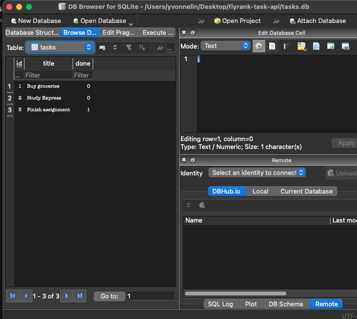

# Task API

A task management API built with Node.js, Express, and SQLite.
Tasks are saved in a database file and survive server restarts.
Swagger UI provides interactive API documentation.

## Requirements

- A current Node.js 22.x release
- npm
- DB Browser for SQLite to inspect the database

For Node 22, use version 22.14.0 or newer. Older patches such as
22.13.1 are incompatible with the native interface used by
better-sqlite3 13.x.

## Setup

```bash
git clone https://github.com/linyvonnea/flyrank-task-api.git
cd flyrank-task-api
npm ci
```

If using nvm, activate a current Node 22 before installing dependencies:

```bash
nvm install 22
nvm use 22
```

## Start the server

```bash
npm start
```

API: http://localhost:3000

Swagger UI: http://localhost:3000/docs

The database file and table are created automatically.
No manual database setup is required.

## Why SQLite?

SQLite keeps the database in a single file, requires no separate
database server, and preserves data across application restarts.

The database is stored in tasks.db beside db.js.
The file is git-ignored so each clone creates its own database.

Startup creates the tasks table if needed and inserts three sample
tasks only when the table is empty. Regular restarts do not duplicate
the seeds. If the table is emptied, the next startup seeds it again.

## Endpoints

| Method | Path | Behavior |
|---|---|---|
| GET | / | API information |
| GET | /health | Server health |
| GET | /tasks | List tasks |
| GET | /tasks/:id | Get one task |
| POST | /tasks | Create a task |
| PUT | /tasks/:id | Update title, done, or both |
| DELETE | /tasks/:id | Delete a task |

Successful reads and updates return 200.
Creating a task returns 201.
Deleting a task returns 204 with an empty body.
Invalid task bodies return 400.
Unknown task IDs return 404.

## Example

On a freshly seeded database:

```bash
curl -i http://localhost:3000/tasks/1
```

Response: HTTP 200

```json
{
  "id": 1,
  "title": "Buy groceries",
  "done": false
}
```

## Database implementation

All CRUD operations use SQL with parameterized placeholders for
user-supplied values.

SQLite stores done as 0 or 1. The toTask helper converts those values
to JSON booleans so the API keeps its original response format.

POST requires a non-empty string title.
PUT accepts a non-empty string title, a boolean done, or both.

## SQL exercise

```sql
SELECT * FROM tasks WHERE done = 1;
```

On the freshly seeded database, this returns the completed task,
“Finish assignment.”

[SQL exploration notes](docs/sql-exploration.md)

## Database screenshot



## Persistence verification

Create a task, restart the server, and retrieve it by ID.
The task remains available because it is stored in tasks.db.

Updates and deletions also persist after restarting the server.


## A3 progress: PostgreSQL in Docker

PostgreSQL 17 runs in a Docker container named taskdb.
Its data is stored in the named volume taskdata.

Create .env from .env.example and set a local database password.
With Docker Desktop running, start the database using:

```bash
docker run --name taskdb \
  --env-file .env \
  -p 127.0.0.1:5432:5432 \
  -v taskdata:/var/lib/postgresql/data \
  -d postgres:17
```

For subsequent starts of the existing container:

```bash
docker start taskdb
```

Open its SQL prompt:

```bash
docker exec -it taskdb psql -U postgres -d tasks
```

At this stage, the API still uses SQLite. Connecting it to PostgreSQL
is the next stage.